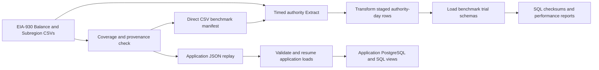

# RenewFlow architecture

RenewFlow runs on one machine. Docker Compose starts PostgreSQL and can enable Airflow with LocalExecutor. Sequential Python and Airflow share the transformation and transactional load functions. The experiment measures the cost and benefit of orchestration on this local setup.

## Data contracts

| Boundary | Data and responsibility |
| --- | --- |
| CSV → workload manifest | The preparation command checks both CSV families and records eligible UTC dates, zone codes, input sizes, and hashes. The benchmark uses the manifest and original files. Application replay also generates authority-day snapshots. |
| Extract → Transform | Each benchmark Extract task scans the original CSVs and stages the rows for its authority and the selected UTC dates. It passes the raw staging reference to Transform. |
| Transform → Load | Transform checks identifiers, periods, values, duplicate hours, and complete UTC coverage. It emits normalized authority-wide and zone rows to staged JSON files and passes the normalized staging reference to Load. |
| Load → analytics | One PostgreSQL transaction writes both sets of rows for an authority-day. The primary keys use authority, UTC hour start, and metric or zone. The SQL views aggregate committed observations. |

The historical DAG has four independent authority chains, each with one Extract, Transform, and Load task. The sequential benchmark executes the same chains in order. Airflow can overlap ready tasks from different chains with four slots. XCom carries small staging references for this DAG. The one-day CISO demo runs three extraction and validation tasks and passes their bounded outputs to one load task.

## Transactions and recovery

- Application writes compare a digest of the validated authority-day to its PostgreSQL completion record. Both the one-day path and the multi-authority loader serialize writes to the same authority-day. Changed values are upserted and the completion record commits in the same transaction. A rollback restores the previous rows and checkpoint. A matching digest lets the loader skip the writes.
- A complete import tracks authority-wide and zone content together. A matching authority-only replay skips the core rows and preserves the full checkpoint. A change to the core rows clears the full checkpoint so the next full import verifies both sets again. Authority-only replay preserves zone rows.
- A benchmark trial uses a fresh schema in `renewflow_benchmark` and writes without application checkpoints. The controlled failure occurs after the third selected CISO day commits. Its retry reuses the staged Transform output and revisits committed days with idempotent upserts. The harness verifies output equality and records the failed and successful attempts.
- Airflow run and task state live in the Airflow metadata database. The application schema and benchmark schemas live in separate databases on the same local PostgreSQL service.

[Application replay and resume](BACKFILLS.md) · [Benchmark protocol](BENCHMARKS.md)
